<div align="center">




</div>

## 🎯 The problem

Every conference, journal and doctoral school must decide **who reviews which paper**. A programme chair with
hundreds of submissions cannot do it well by hand: poor matches give shallow reviews and wrong decisions, and
a missed **conflict of interest** (a co-author, a colleague) undermines the whole process. Reviewers have limited
time, every paper needs its reviews, and some papers fit almost nobody.

This app does it in seconds and shows its work: **who knows each paper best and why**, **no conflicts**, **every
workload respected**, and a **certificate that no better assignment exists**.

## ✨ What it does

| Feature | Details |
|---|---|
| 🔎 **Measures expertise** | from each reviewer's own papers (TF-IDF, recency-weighted soft maximum), with **the closest paper and shared terms** as the reason |
| 🚫 **Finds conflicts** | authors, co-authors (optionally only recent), same institution or e-mail domain, declared conflicts, "conflict" bids |
| 📏 **Respects the rules** | reviews per paper, min / max load, at most one reviewer per institution, an experienced reviewer on every paper, bids |
| ✅ **Proves the optimum** | linear programming with column generation: only the best candidates in memory, dual prices prove nothing better was left out |
| ⚖️ **Three goals** | highest total expertise · **fair** (lift the worst-off paper) · **randomised** (no pair above a set chance, against bid manipulation) |
| 🔁 **Re-plans** | a reviewer drops out: keep every pair that can stay, move only what must |
| 📤 **Exports** | Excel workbook (pairs with reasons, papers, reviewers, conflicts, settings) and CSV for conference systems |

## 📸 The app

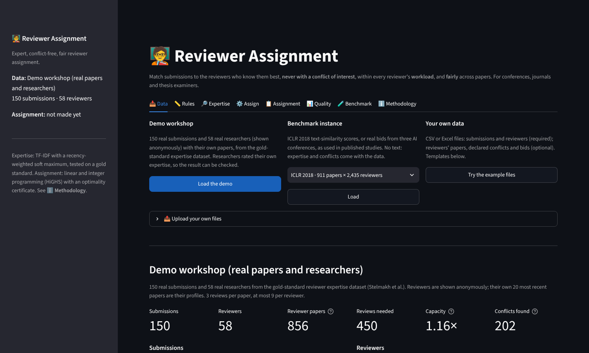

| **Who knows this paper best, and why** | **Find reviewers for any abstract** |
|:---:|:---:|
| 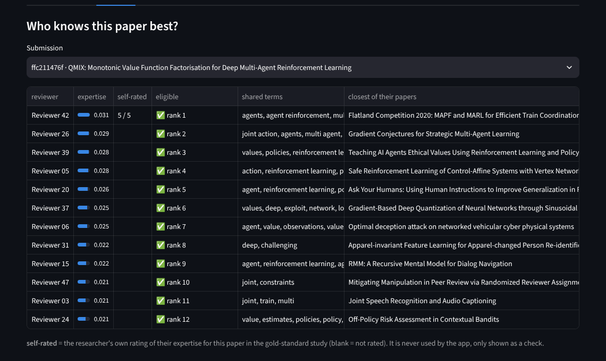 | 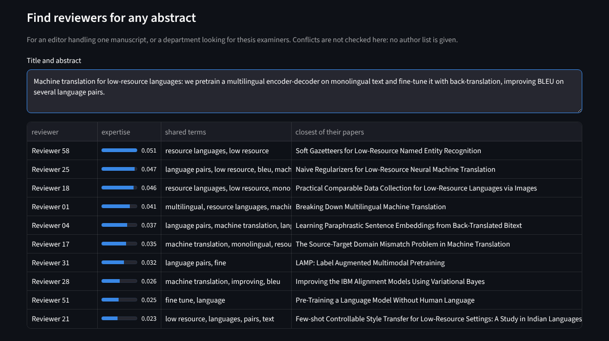 |
| The #1 match rated their own expertise **5 / 5** | For one journal manuscript or a thesis examiner search |
| **Assign, with a certificate** | **Compare the goals** |
| 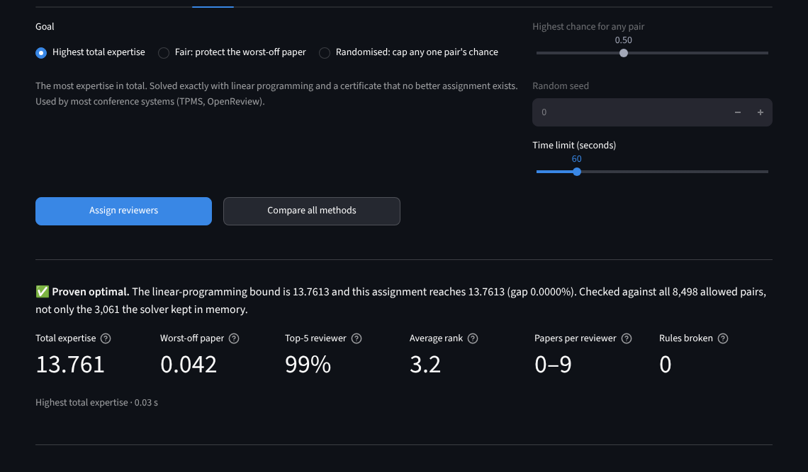 | 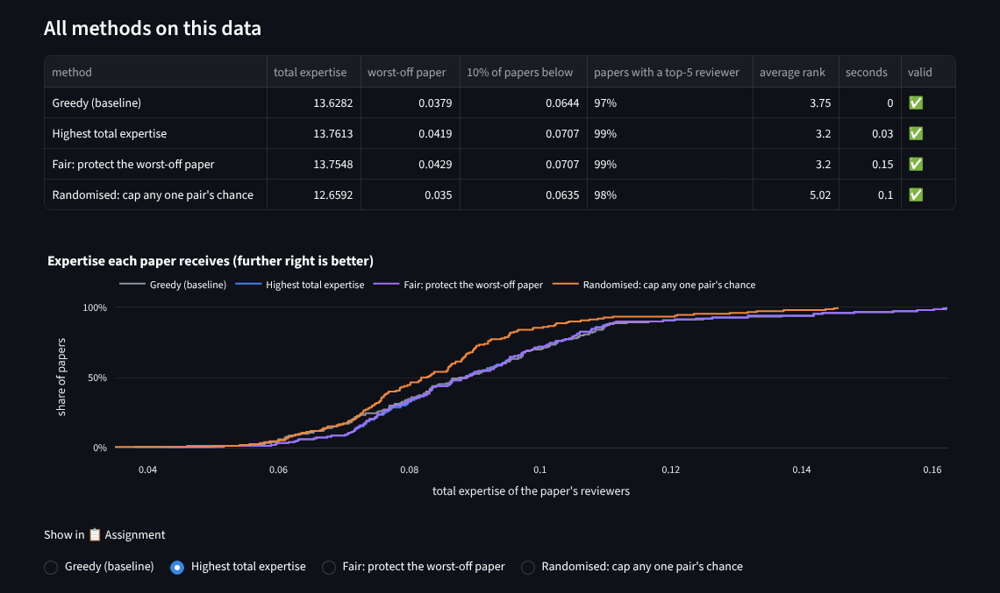 |
| LP bound = assignment: **proven optimal**, 0 rules broken | Greedy, highest total, fair and randomised on the same data |
| **Every pair explained** | **A reviewer drops out** |
| 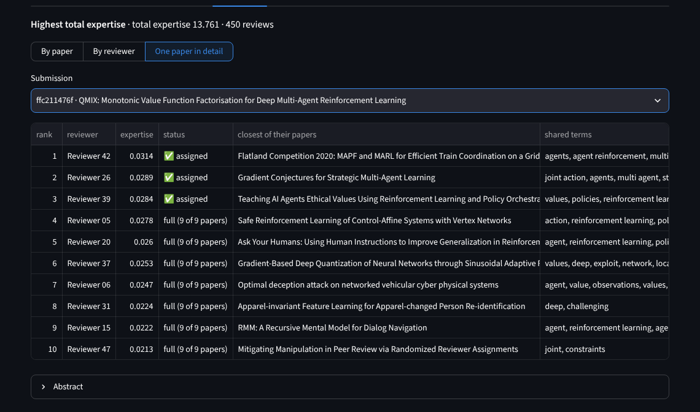 | 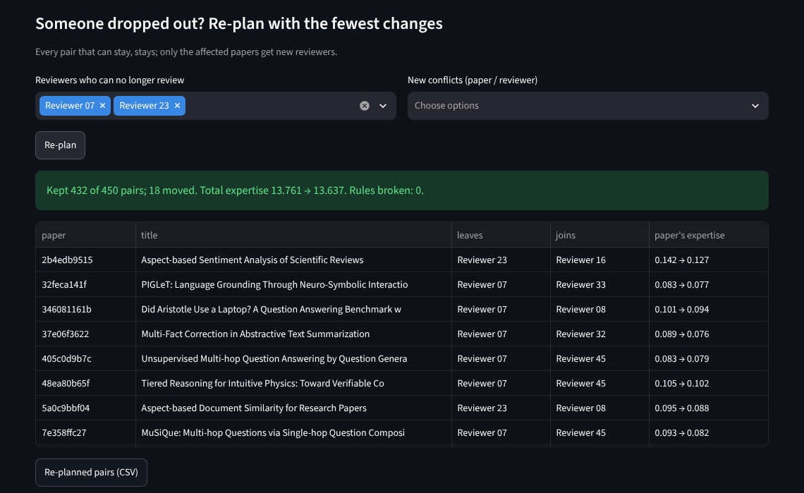 |
| Why the next-best reviewers were not chosen | Two drop-outs: **432 of 450 pairs kept**, only their 18 papers change |
| **Assignment map** | **Outside check: researchers' own ratings** |
| 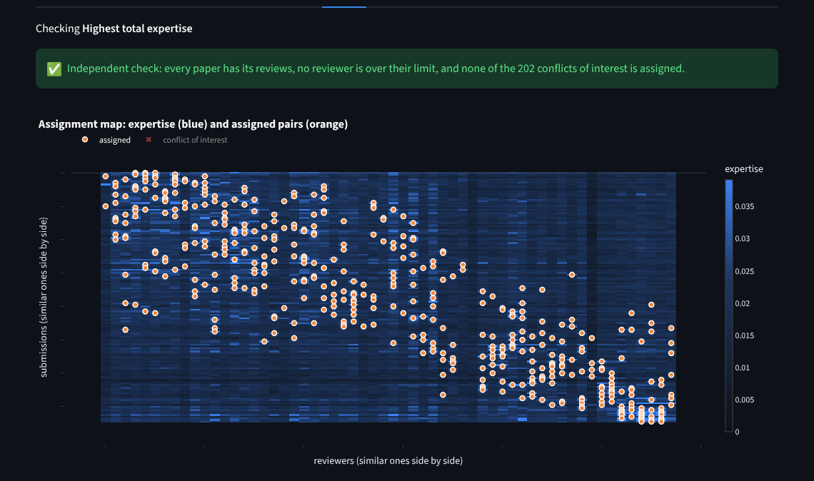 | 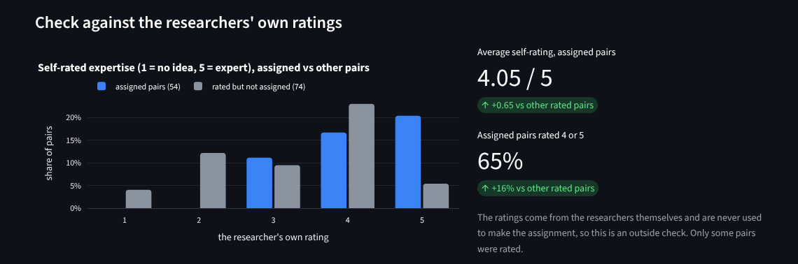 |
| Similar papers and reviewers side by side: the assignment follows expertise | Assigned pairs: **4.05 / 5**, other rated pairs 3.40 |
| **Rules and conflicts of interest** | **Papers that are hard to cover** |
| 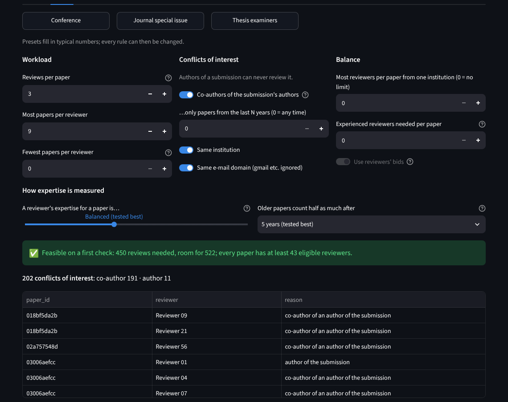 | 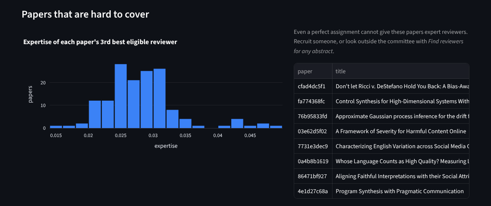 |
| Presets for conferences, journals and thesis examiners; 202 conflicts found automatically | Spot papers nobody knows well, before assigning |

## 🧪 Benchmarks

**1 · Is the expertise score right?** On the gold-standard dataset of Stelmakh et al. (TMLR 2025), researchers rated
their own expertise for papers they had read. The app's score is compared with published methods, scored from the
predictions their authors released, with the same code.


> Better than **TPMS** (used by many conferences), SPECTER, ELMo, the ACL matcher and two LLMs, level with SPECTER2 and
> o1-mini, with **no GPU, no training and no paid API**. Settings were chosen by cross-validation over researchers (held-out error 0.249).

**2 · Is the assignment right?** Real instances: ICLR 2018 text similarities (Xu et al. 2019) and real bids from three
AI conferences (PrefLib), as used by Jecmen et al. (NeurIPS 2020).

| Instance | Size | Capacity | Proven optimal | Greedy | Worst-off paper: optimal → fair | Cost of fairness |
|---|---|---|---|---|---|---|
| ICLR 2018 | 911 × 2,435 | 5.35× | **0.3 s** (full LP: 16.9 s) | −0.4% | 0.114 → 0.115 | 0.002% |
| ICLR 2018, scarce reviewers | 911 × 1,000 | 1.10× | 6.5 s | −2.2% | 0.071 → **0.099** (+39%) | 0.10% |
| AI conference 3, scarce | 176 × 146 | 1.11× | 0.1 s | −8.2% | 1.0 → **1.5** (+50%) | none |
| AI conferences 1–3 | 52–176 papers | 1.08–1.66× | < 0.1 s | −2.6 to −3.5% | unchanged | none |
| Demo workshop | 150 × 58 | 1.16× | 0.03 s | −1.0% | 0.042 → 0.043 | 0.05% |


Every run of every method was valid (0 conflicts, 0 overloads), checked by a separate rule checker. Randomised with
a 50% cap keeps 91% of the optimal total on ICLR 2018; 2,000 samples matched their planned probabilities within 0.03.

## 🧠 How it works


| Step | In plain words |
|---|---|
| **Expertise** | Each reviewer's papers become word and word-pair vectors. A reviewer scores high if a **few of their papers are very close** to the submission (soft maximum), and **recent papers count more** (half-life 5 years). |
| **Conflicts** | Names are compared without accents, an initial matches a full first name (the safe side); co-authors come from the reviewer's own author lists. |
| **Optimal assignment** | An integer program. Its plain version is *totally unimodular*, so the linear program already gives whole pairs; only the best candidates per paper are kept, and dual prices prove that no left-out pair could help. Extra rules fall back to a MILP (HiGHS). |
| **Fair** | First maximise the expertise of the worst-off paper, then the total (PeerReview4All). The bound "no paper beats its own best reviewers" is tried first and often proves the optimum at once. |
| **Randomised** | Plan with probabilities (no pair above *q*), then sample with dependent rounding, which keeps every count exact (Jecmen et al. 2020). |
| **Re-plan** | Each pair that may stay earns a bonus larger than any gain from moving it, so the new optimum changes as little as possible. |

## 🚀 Quick start

```bash
git clone https://github.com/harshadulshan/reviewer-assignment.git
cd reviewer-assignment
pip install -r requirements.txt
streamlit run app.py
```

Click **Load the demo** (downloads about 2 MB once), then **⚙️ Assign → Assign reviewers**.

**Your own data:** CSV or Excel. Templates in [`sample_data/`](sample_data) (fictional people); column names are
matched loosely (`id`, `paper`, `submission_id` all work).

| File | Columns |
|---|---|
| Submissions * | `paper_id`, `title`, `abstract`, `authors` (`;`-separated), `author_emails`, `author_institutions`, `keywords`, `reviews_needed` |
| Reviewers * | `reviewer_id`, `name`, `email`, `institution`, `max_load`, `min_load`, `experienced`, `expertise` (a short statement) |
| Reviewers' papers | `reviewer_id`, `title`, `abstract`, `year`, `authors` |
| Conflicts · Bids | `paper_id`, `reviewer_id` · plus `bid`: eager, willing, neutral, in a pinch, not willing, conflict |

## ✅ Verified

```bash
python tests/verify_engine.py      # solver vs dense integer programs, conflicts, expertise, files, mutation test
python tests/verify_app.py         # clicks through every tab with each data source
python benchmarks/run_benchmark.py # everything above, about 4 minutes on 2 cores
```

- **Optimal**: equals a dense integer program over every pair on 53 random instances with institution, experience and
  minimum-load rules. **Fair** equals the dense max-min optimum on 38. **Re-plan** keeps the most pairs possible on 27.
- **Mutation test**: 9 bugs planted one at a time (pricing off, no keep bonus, independent rounding, surname-only name
  matching, co-author window ignored, ...). All 9 caught.

## ⚠️ Limitations

- Text similarity only knows what is in the reviewer's papers: add an `expertise` statement for reviewers with few papers.
- Two people with the same surname and first initial are treated as one: an extra conflict, never a missed one.
- The gold standard covers 58 computer-science researchers; other fields were not tested.

<details>
<summary><b>📂 Project structure, data & references</b></summary>

```
app.py                     Streamlit interface (8 tabs)
revassign/expertise.py     TF-IDF, recency-weighted soft maximum, explanations, scoring of pasted abstracts
revassign/conflicts.py     name matching, co-authors, institutions, e-mail domains
revassign/problem.py       the assignment problem and plain-language feasibility checks
revassign/solve.py         column generation LP, MILP, fair, randomised + dependent rounding, greedy, re-plan
revassign/evaluate.py      independent rule checker and quality measures
revassign/io.py            CSV / Excel reading, settings, building the problem
revassign/data.py          demo workshop, ICLR 2018 and PrefLib instances (downloaded, SHA-256 checked)
revassign/report.py        tables, Excel and CSV
benchmarks/                run_benchmark.py, results.json
sample_data/               fictional example files (templates)
tests/                     verify_engine.py, verify_app.py
```

**Data.** Gold-standard expertise dataset: Stelmakh, Wieting, Xi, Neubig & Shah (TMLR 2025), evaluations CC BY 4.0;
paper metadata from Semantic Scholar, downloaded when used and not redistributed. ICLR 2018 similarities: Xu et al.
(2019) via Jecmen et al. (2020). Bids: PrefLib dataset 00039 (Mattei & Walsh 2013).

- Stelmakh, I., Wieting, J., Xi, Y., Neubig, G., & Shah, N. B. (2025). A gold standard dataset for the reviewer
  assignment problem. *Transactions on Machine Learning Research*.
- Stelmakh, I., Shah, N. B., & Singh, A. (2021). PeerReview4All: Fair and accurate reviewer assignment in peer review.
  *Journal of Machine Learning Research*, 22(163), 1–66.
- Jecmen, S., Zhang, H., Liu, R., Shah, N. B., Conitzer, V., & Fang, F. (2020). Mitigating manipulation in peer review
  via randomized reviewer assignments. *NeurIPS 2020*.
- Charlin, L., & Zemel, R. (2013). The Toronto Paper Matching System. *ICML Workshop on Peer Reviewing and Publishing Models*.
- Gandhi, R., Khuller, S., Parthasarathy, S., & Srinivasan, A. (2006). Dependent rounding and its applications to
  approximation algorithms. *Journal of the ACM*, 53(3), 324–360.
- Huangfu, Q., & Hall, J. A. J. (2018). Parallelizing the dual revised simplex method. *Mathematical Programming
  Computation*, 10, 119–142. (HiGHS)

</details>

<div align="center">

**Harsha Dulshan** · BSc (Hons) Management Information Systems, NSBM Green University
[GitHub](https://github.com/harshadulshan) · [LinkedIn](https://www.linkedin.com/in/harsha-kaldera/) · MIT License

</div>
